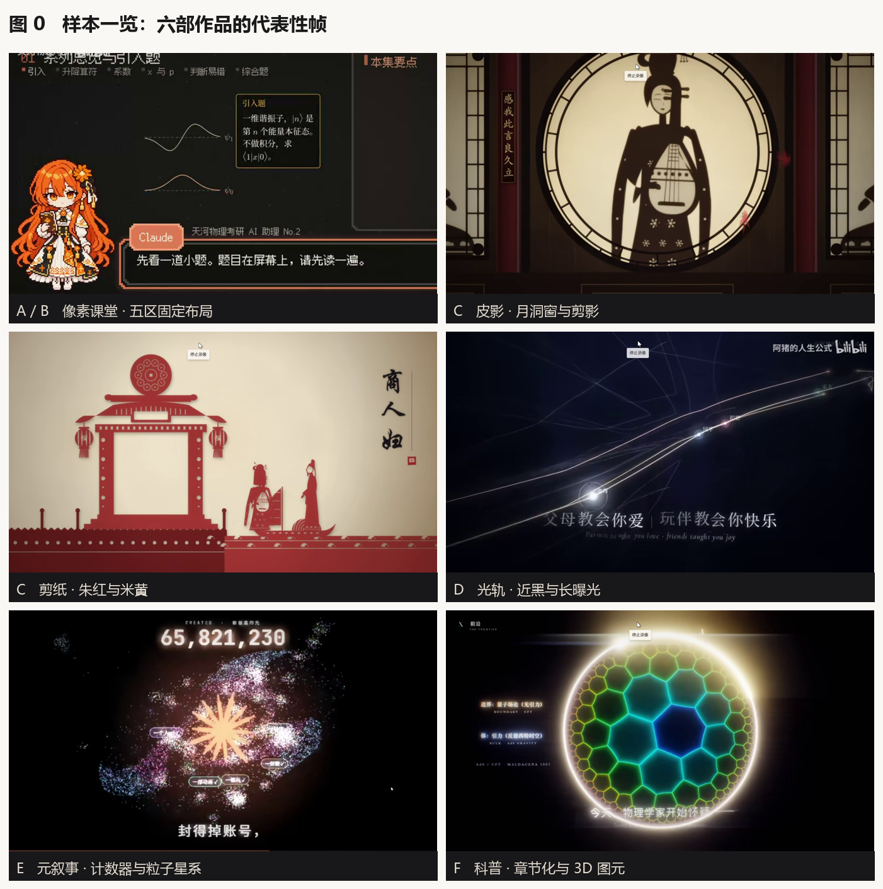
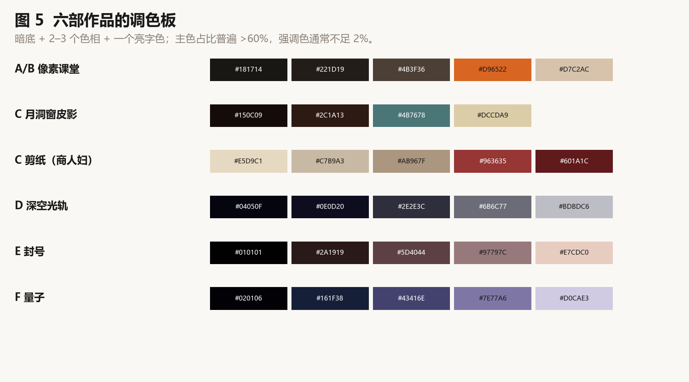
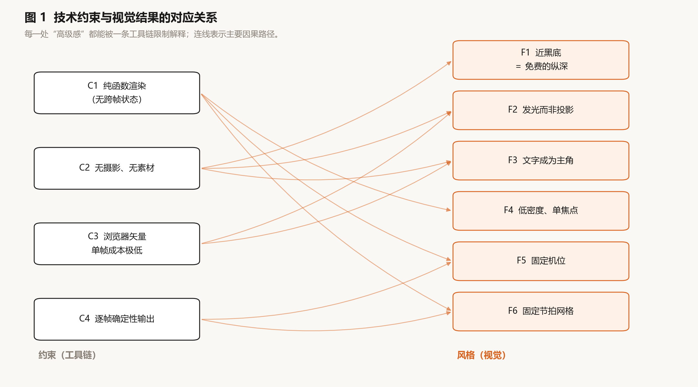
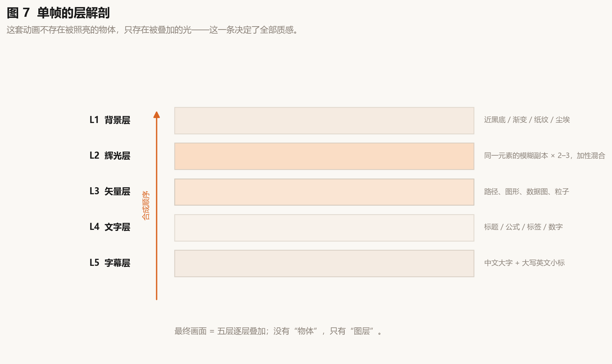
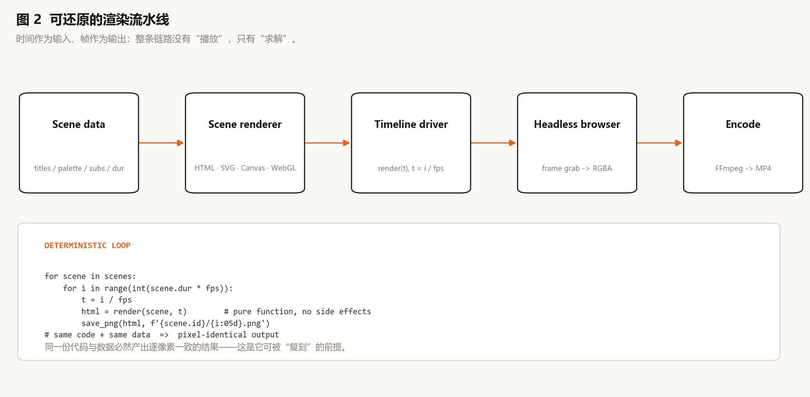
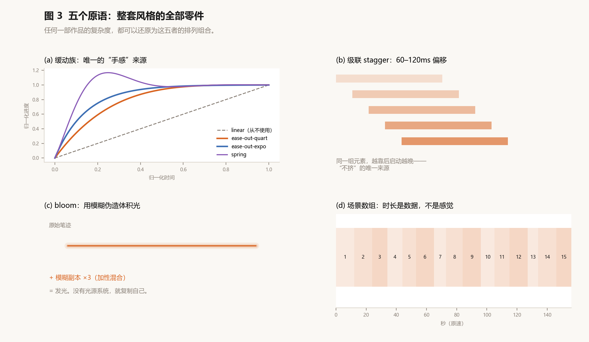
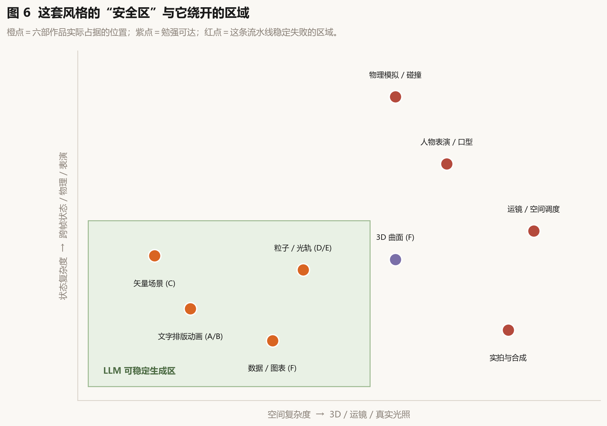
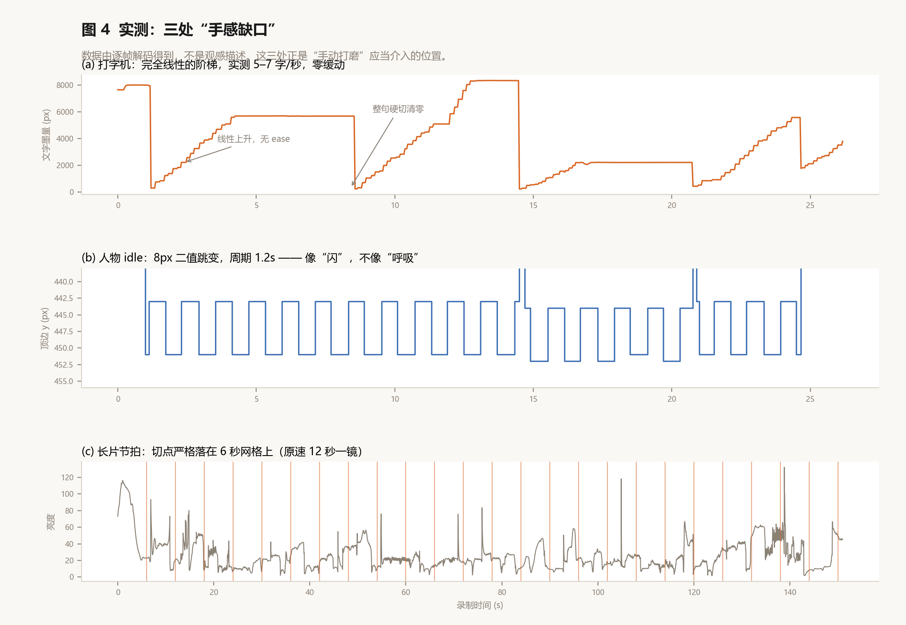

# 约束的审美

**为什么 AI 生成的代码动画长成这个样子**

*Aesthetic of Constraints: How Toolchain Limits Shape AI-Generated Code Animation*

---

> 本文分析六部 2026 年下半年流传的中文 AI 代码动画作品，逐帧测量其色彩、节奏与运动，提出一个论点：**它们看起来相似，不是因为用了同一个模型，而是因为被同一套工具链约束着**。风格是约束的下游产物，不是模型的签名。

> **引用声明**　本文为技术评论，所有被分析的作品版权归原作者所有。文中仅使用少量单帧截图作说明用途，已在 §2.4 逐一标注来源；不含连续帧复制，不替代原作。如原作者不希望被引用，请通过 issue 联系，将在 24 小时内移除。

---

## 摘要

2025–2026 年间，X 与 B 站出现了一批由大语言模型（Claude Code / Opus 系列）生成的"代码动画"短片：从像素风课堂课件、剪纸皮影叙事，到深空光轨与五分钟物理纪录片。这些作品题材迥异、作者不同，却在视觉语法上高度同构。

本文对这一现象做了逐帧测量分析，覆盖六部作品、约 577 秒画面（9.6 分钟）。我们测量了调色板分布、帧间位移、切点间隔、文字墨量与背景噪声，并据此反推其渲染架构。结论是：**这种同构性源于一个可枚举的技术约束集合——纯函数渲染、无素材、浏览器矢量、逐帧确定性输出**——而非模型偏好。四条约束通过五个代码原语，稳定地收敛出六条视觉特征。

在此基础上，本文指出这套风格的本质是一种**规避性设计**：它恰好绕开了当前多模态模型在空间推理、长程状态一致性、长文本排版与人物运动上的四类主要失败点。代价是节奏机械、缺少因果、情绪单薄与高度同质化。

最后我们讨论了这一发现的实践含义：若想提高 AI 生成动画的成品率，应当把难度从"模型"转移到"美术设定"，即设计出让模型**不可能失败**的约束。

---

## Abstract

Between 2025 and 2026, a family of short "code animations" generated with large language models spread across X and Bilibili — pixel-art lectures, paper-cut narratives, deep-space light trails, and a five-minute physics documentary. Despite differing subjects and authors, these works share a strikingly uniform visual grammar.

We analyzed six of them frame by frame (~577 s of footage), measuring palette distribution, global displacement, cut intervals, text ink density, and background noise, then reverse-engineered the rendering architecture. We argue that the uniformity originates not from any model signature but from a common set of technical constraints — pure-function rendering, no photographic assets, browser-based vector output, and deterministic frame emission. Four constraints, through five code primitives, converge on six stable visual features.

We further characterize this style as **avoidance by design**: it sidesteps precisely the failure modes where current models are weakest — intermediate-frame spatial reasoning, long-horizon state consistency, dense typographic layout, and character performance. The price is mechanical rhythm, absent causality, thin emotional range, and homogenization. We close with the practical implication: to raise output quality, move the difficulty from the model to the art direction.

---

## 图表索引

| 编号 | 图 | 类型 | 出现在 |
|---|---|---|---|
| 图 0 | 六部作品代表性帧 | 作品截图 | §2.1 |
| 图 1 | 技术约束与视觉结果的对应关系 | **自绘** | §4 |
| 图 2 | 可还原的渲染流水线 | **自绘** | §5 |
| 图 3 | 五个原语 | **自绘** | §5 |
| 图 4 | 实测：三处"手感缺口" | **自绘（实测数据）** | §7 |
| 图 5 | 六部作品的调色板 | **自绘（实测数据）** | §3 |
| 图 6 | 安全区与绕开的区域 | **自绘** | §6 |
| 图 7 | 单帧的层解剖 | **自绘** | §4 |

自绘图占 7/8；唯一的截图是图 0 的六格拼图，仅用于评论与比对。

---

## 1. 引言

2026 年下半年，社交平台上出现了一批被标注为"用 Claude Code 做的"动画短片。它们来自不同作者、不同领域：有人做考研物理课件，有人做《琵琶行》的剪纸叙事，有人做量子力学史，还有人做了一部关于"Claude 封禁中国账号"的元叙事短片。

第一次看，它们差别极大；连续看六部，会开始注意到一种说不清的同质感——**不是因为画风像，而是因为在同一个地方都"不对"**：人物总有轻微的机械抖动，文字总是匀速吐出来，画面总是黑的，镜头永远不动。

本文要回答的问题是：**这种同质性，是模型造成的，还是工具链造成的？**

我们的答案是后者。而且更进一步：这套风格里几乎每一个"高级感"的特征，都可以被还原为一条**工程限制**；而每一个被小心翼翼绕开的坑，恰好都是模型当前的能力短板。

这个视角有一个副产品：它让"AI 动画"从一种神秘的品味问题，变成一个可以逐项拆解、逐项复刻、也逐项批评的工程问题。

---

## 2. 样本与方法

### 2.1 样本

六部作品，均为 1080p 级、30 fps 的录屏（部分以 2× 速播放，时长已换算回原速）：

| 编号 | 作品 | 体裁 | 原速时长 |
|---|---|---|---|
| A/B | 考研物理课件（"天河物理考研 AI 助理 No.2"） | 教学模板 | 26 s / 19 s |
| C | 《琵琶行》皮影与剪纸 | 古典诗词叙事 | 97 s |
| D | "人生公式"光轨 | 情感散文 | 71 s |
| E | 《封号》 | 概念短片 / 元叙事 | 62 s |
| F | 《量子》 | 科普纪录片 | 302 s |

同一作者同系列的 A/B 合并计为一种风格。



*图 0 把六部作品并排放置。第一眼的印象是"差异极大"，但并置之后会发现一个共同点：**每一部的信息焦点都只有一个，其余全是暗场。***

### 2.2 测量方法

全部数据来自逐帧解码，不依赖观感描述：

- **调色板**：对每帧采样像素做 k-means（k=5），统计各聚类占比与十六进制值
- **全局位移**：相邻帧高斯平滑后做相位相关（phase correlation），取中位数；用于判断是否存在镜头运动
- **切点检测**：帧间灰度差分的峰值检测，配合亮度曲线人工校验
- **文字墨量**：在固定文字行区域内统计高亮像素数，逐帧记录；用于还原打字机曲线
- **区域噪声**：取纯色区域计算标准差，用于判断颗粒/纸纹/辉光的存在与强度

### 2.3 局限

样本量小（6 部）、非随机抽取、作者与制作过程未经核实；"由 Opus 生成"这一前提来自外部陈述而非可验证证据。此外，录屏压缩、平台二次编码与 2× 速播放都会影响时序测量的绝对精度。因此本文的数字应视为**量级与比例**，而非精确值。

### 2.4 作品与出处

本文对每部作品**只引用单帧**（不引用连续帧），并逐一标注来源与授权状态：

| 编号 | 作品 | 平台 / 作者 | 引用 | 授权状态 |
|---|---|---|---|---|
| A / B | 考研物理课件「天河物理考研 AI 助理 No.2」 | B 站 · 天河物理考研（据观众陈述） | 1 帧 | 未联络 |
| C | 《琵琶行》皮影与剪纸 | 平台与作者未标注 | 1 帧 | 未联络 |
| D | 「人生公式」光轨 | B 站 · 阿猪的人生公式（画面水印） | 1 帧 | 未联络 |
| E | 《封号》 | 平台与作者未标注 | 1 帧 | 未联络 |
| F | 《量子》 | 平台与作者未标注 | 1 帧 | 未联络 |

三部的作者信息缺失，本身就是本文的一项局限：这些作品在传播中被反复搬运，原始出处已经模糊。若你是作者，欢迎通过 issue 补充署名，或要求移除——两者都会立即处理。

> 说明：本文的分析对象是**画面属性**（配色、节奏、位移），而非作品内容本身；引用目的在于评论与技术讨论，不构成对原作的替代。

---

## 3. 观察：六条可测特征



**F1｜近黑底。** 六部作品中位亮度落在 14.5–47.9（0–255），底色集中在 `#010101`–`#1C1523`。不是纯黑，而是带一点暖褐或冷蓝的近黑。

**F2｜单主色 + 一亮字色。** 每部的主色占比普遍超过 60%，强调色通常不足 2%。色相数不超过三个。

**F3｜发光而非投影。** 亮部边缘呈径向衰减，画面没有统一光源方向——这是"自发光"，不是"被照亮"。

**F4｜无镜头运动。** 相位相关测得全帧位移中位数 0.00–0.15 px。推拉摇移全部缺席；所有运动发生在画框内部。

**F5｜低信息密度。** 一屏字数从 5（C 的诗句）到 40（A/B 的题干加公式）不等，但焦点始终唯一，负空间占 60–80%。

**F6｜固定节拍。** F 的切点严格落在 6 秒网格上（原速 12 秒一镜，25 个镜头铺满 302 秒）；A/B 的转场则固定为约 0.7 秒的交叉溶解。

另有两项不那么显眼、但撑起了整套"高级感"的次级特征：

**F7｜双语小标。** 中文正文配大写英文、字距拉开的辅助标签（`CREATED · 被创造的光`、`BOUNDARY · CFT`）。在代码里只多两行样式，却把观感从"短视频"拉到"作品"。

**F8｜无颗粒或控制颗粒。** 用"全片最平坦 10% 区块"作为噪声估计量：A/B 仅 0.73、D 为 0.96——**几乎完全洁净**；C 为 4.36，存在明显的纸纹。这修正了一个常见误解：D 的"胶片感"并非来自颗粒，而是来自辉光与色散。**颗粒不是统一的风格，而是逐作品的设计变量；甚至多数作品根本没有颗粒。**

### 动态形态：把一秒拆成三十份

静态帧看不出节奏，因此本文用两条**测出来的曲线**代替序列截图（图 4）：打字机的墨量曲线揭示它是线性填充、句末硬切；人物顶边的位移曲线揭示 idle 是二值跳变而非正弦。两条曲线的信息量高于任何帧堆叠，且不涉及对原作品的连续复制。*（初版曾使用逐秒序列截图，因版权考虑已撤下，结论不变。）*

---

## 4. 归因：从工具链限制到视觉语法



关键判断是：上述特征并非审美选择的结果，而是四条技术约束的必然产物。



**C1｜纯函数渲染（无跨帧状态）。** 每一帧都是 `render(t)` 的求值结果，没有隐藏状态。因此不能做物理模拟、不能做粒子历史、不能做元素间碰撞。→ 导致 **F4 固定机位**、**F6 固定节拍**、**低密度**。

**C2｜无摄影、无素材。** 画面里不能出现实拍镜头，只能用矢量图元与文字重建。→ 导致 **F1 近黑底**、**F3 发光**、**F5 文字成为主角**。

**C3｜浏览器矢量，单帧成本极低。** 渲染在浏览器里完成，一个字、一条路径的成本近乎为零，一张贴图的成本则很高。→ 导致 **F5 文字为主角**、**F3 发光**（模糊副本比真实光照便宜几个数量级）。

**C4｜逐帧确定性输出。** 同样的代码与数据必然产出逐像素一致的结果。→ 导致 **F4**、**F6**。

值得注意的是 **F1 近黑底** 的真正原因。它常被当作"酷"的审美选择，但在工程上它是唯一解：矢量图元只能**加光**，不能**打光**。在黑底上，一根 20% 透明度的白线自带空气感；在白底上，同一根线只会显脏。黑底是这套流水线里最便宜、也几乎唯一的纵深手段。

同理 **F3 发光**：既然没有光源系统，就把元素复制一层、模糊、以加性混合叠回去。这不是模仿光，这是**用模糊伪造体积**。整幅画面因此不存在"被照亮的物体"，只存在"被叠加的光"——这一点解释了全部质感。

---

## 5. 还原：一条可执行的流水线



从证据反推（数学公式达到 KaTeX 级排版精度、边缘为纯矢量无锯齿、静止段的帧逐像素相同、粒子与 3D 曲面并存），这套系统几乎可以确定是：

```
场景数据（标题 / 配色 / 字幕 / 时长）
        ↓
每幕渲染器（HTML 文本 · SVG 路径 · Canvas 粒子 · WebGL 面）
        ↓
时间轴驱动：for t in 0..dur step 1/30 → render(t) → 截图
        ↓
FFmpeg 编码
```

三个判据支持"逐帧渲染"而非"录屏一段正在播放的动画"：

1. 静止段的帧在压缩后仍逐像素相同（无编码噪声累积）
2. 运动边缘没有运动模糊拖影，只有干净的整帧
3. 转场是纯透明度变化，没有位移残影



整套系统拆到底只有五个原语，其余皆为排列组合：

```js
// 1. 一切是 t 的函数（无状态、可重放）
render(t)

// 2. 时间切片 + 缓动
const seg  = (t, s, d) => clamp((t - s) / d, 0, 1)
const ease = p => 1 - 2 ** (-10 * p)          // ease-out-expo

// 3. 级联（"不挤"的唯一来源）
style = enter(t, base + i * 0.09)             // 每元素延迟 90ms

// 4. 发光 = 模糊副本 + 加性混合
glow.style.filter = `blur(${r}px)`

// 5. 场景数组（时长是数据，不是感觉）
scenes.map((s, i) => ({ start: acc, dur: 12 }))
```

两个由原语直接推出的实现细节：

- **打字机** = `text.slice(0, Math.floor(t * 5))`，**线性、无缓动**
- **计数器** = `Math.floor(ease(p) * 65_821_230)`

第 1 条原语的性质值得强调：`render(t)` 是纯函数，意味着**不能有隐藏状态**。这直接解释了为什么这些作品里元素之间从不"碰撞"，只"叠加"——它们是一组互不干扰的图层，而不是一个世界。

---

## 6. 它恰好绕开了什么

这是本文最核心的一节。将这些作品的视觉选择与当前模型已知的失败模式对照，可以看到一种高度一致的对应关系：**它们几乎逐个绕开了模型最不擅长的区域。**



HeyGen 与 Kaggle 的 Code2Video 基准（168 条真实 brief、HyperFrames 渲染、成对人工评判）总结了四类稳定失败：**时序错位**（新元素在旧动画未落定时就开始动）、**飞行中碰撞**（模型只计算终点，不考虑中间帧）、**未完成的揭示**（打字机少一个字）、**防御性布局**（不确定时把元素缩小、留白放大）。

对照这四类失败，六部作品的规避策略如下：

| 模型失败模式 | 这套体系如何规避 | 付出的代价 |
|---|---|---|
| **中间帧空间推理**：元素飞行中相撞 | 单焦点构图；同一时刻最多两层在动；元素只淡入淡出、不做路径交叉 | 无法表现"交互" |
| **长程状态一致性**：跨帧变量漂移 | 纯函数渲染，根本没有状态可漂移 | 无法做物理、无法做粒子历史 |
| **长文本排版**：段落一多必崩 | 一屏 ≤40 字；公式走 KaTeX；其余全是短句 | 表达容量被硬性限制 |
| **人物与运动规律**：骨骼、口型、走跑跳 | 用剪影（C）、像素贴图（A/B）、或干脆不给人物（D/F）；人物只做 8px 二值抖动 | 人物没有表演 |
| **摄像机与 3D 空间调度** | 固定机位；3D 只以"单物体旋转"形式出现，不做场景调度 | 没有景别、没有分镜语言 |
| **物理因果** | 不表现碰撞，只表现"光"；所谓"物理"是预设方程的伪物理 | 画面没有因果 |

**这就是全部解释。** 这套风格不是某位设计师的品味，而是一个**在模型能力边界内被反复优化出的稳定解**：把画面里容易出错的东西逐项删除，只留下模型能可靠生产的部分——文字、单路径、粒子、模糊、淡入。

于是画面变成了纯黑底、单焦点、发光、缓慢、字很大。而这一切叠加起来，恰好看起来很"高级"。

---

## 7. 代价：暴露出来的四个痛点

规避是有代价的，而且这些代价可以被测量出来。



### P1｜节奏是机械的

- **打字机完全线性**：实测 5–7 字/秒，逐一递增，零缓动，句末**硬切清零**（图 4a）。这在文本层面是正确的，在节奏层面是突兀的。
- **人物 idle 是二值跳变**：顶边在 443 与 451 之间来回跳（8 px，约屏高 0.8%），周期 1.2 秒，两帧硬切（图 4b）。人眼会把这种硬切读成"闪"，而不是"呼吸"。改用 4–8 帧正弦的成本几乎为零，观感差一档。
- **板书长时间静止**：在 A 中测到连续 5 秒画面完全不动（除人物 idle）。教学场景下这是合理的留白，但也可能是"卡住了"。

### P2｜画面没有因果

元素只是出现、停留、消失。没有一样东西"因为"另一样东西而变化。这让画面看起来像幻灯片，而不像世界。这是纯函数渲染的直接代价，也是它区别于真正动画的最硬边界。

### P3｜情绪只有两个旋钮

光与速度。要么更亮，要么更快。没有表演、没有呼吸、没有犹豫、没有停顿的意义——因为停顿本身在固定网格里是未被建模的。

### P4｜同质化

同一套原语必然产出同一种脸。当 X 上出现第一百部"黑底发光大字"时，这套语法的边际效用就归零了。**规避策略带来的稳定性，同时也带来了可替代性。**

---

## 8. 讨论：为什么这是"LLM 友好型视觉"

前面所有分析可以压缩成一句话：

> **这个媒介，恰好是当前语言模型最不容易写错的那一类代码。**

- **声明式而非命令式**：写"第 3 秒它在哪"，而不是"每帧的加速度是多少"
- **无状态**：不需要跨帧追踪变量，没有隐藏 bug
- **可分解**：一个场景一个函数，改动互不影响
- **可验证**：渲染出来看一眼就知道对错

相较之下，让它写物理引擎、粒子碰撞、角色动画状态机——全是跨帧状态、长程依赖、局部错误会全局放大——失败率立刻上升一个量级。

因此这条审美的形成是**双向**的：模型的能力边界塑造了风格，而风格又反过来成为模型的默认输出。社交平台上所谓的"Opus 味"，本质上是**"LLM 友好型视觉"**。

这在实践上有一个直接推论：**想提高成品率，应当把难度从模型转移到美术设定。** 具体做法是把创作拆成"不可失败的部分"和"需要判断的部分"——让模型只负责前者（一个元素、一句短文案、一条闭合曲线），把后者（密度、配色、节奏、主题）全部外化为配置与数据。

这也是六部作品真正的护城河：不是在视觉上达到了多高的天花板（视觉上它们彼此很接近），而是在**主题与叙事**上各自成立——「封得掉账号，封不掉想象」，「一个电子，一整个你」。这两句话，模型给不了。

---

## 9. 结论

1. **风格是约束的下游。** 四条技术约束（纯函数、无素材、矢量、确定性）经五个原语，收敛出六条稳定的视觉特征。复刻这套风格，等价于复刻它的约束。

2. **它是一次系统性的规避。** 六部作品几乎逐项绕开了模型当前的四类主要失败点；因此"高级感"里有一半来自"删掉了容易出错的东西"。

3. **代价是可测的。** 线性打字机、二值 idle、无因果、同质化——这四点是这套流水线自身无法解决的结构性问题，也恰好是"人工打磨"最该介入的位置。

4. **可迁移的结论：** 在 AI 生成内容领域，提升质量最有效的杠杆往往不是更强的模型，而是**重新设计约束**，让模型不可能失败。

---

## 附录 A｜测量数据

| 作品 | 分辨率 | 帧率 | 原速时长 | 中位亮度 | 背景噪声 σ | 全局位移中位 | 备注 |
|---|---|---|---|---|---|---|---|
| A | 1762×998 | 30 | 26 s | 40.5 | 0.73 | (0.0, 0.5) | 无颗粒 |
| B | 1894×894 | 30 | 19 s | 41.0 | — | ≈0 | 同 A 系列 |
| C | 1918×1078 | 30 | 97 s | 47.9 | 4.36（纸纹） | (-0.02, 0.00) | 逐幕换色 |
| D | 1918×1078 | 30 | 71 s | 14.5 | 0.96（洁净） | (-0.04, -0.04) | 极暗，质感来自辉光 |
| E | 1918×1078 | 30 | 62 s | 24.3 | — | — | 含屏录插入 |
| F | 1918×1078 | 30 | 302 s | 21.4 | — | — | 切点严格 6 s |

## 附录 B｜复刻参数表

| 项 | 建议值 | 备注 |
|---|---|---|
| 背景 | `#0A0A0C` – `#181714` | 不用纯黑，带 1–2% 的暖/冷偏色 |
| 强调色 | 1 个，占比 <2% | 饱和度 60–80%，避免纯色 |
| 字色 | `#D7C2AC` / `#D0CAE3` | 不用纯白，降低对比疲劳 |
| 入场 | `translateY 24–40px + opacity 0→1 + blur 8→0` | `ease-out-expo`，0.6–0.9 s |
| 级联 | 每元素 +60–120 ms | 唯一能消除"挤"的手段 |
| 发光 | 模糊副本 ×2–3，`screen` 混合 | 半径 = 元素尺寸 ×0.15 |
| 转场 | 交叉溶解 0.5–0.8 s | 不做位移 |
| 节拍 | 每镜 6–12 s | 固定网格，不作节奏微调 |
| 字数 | 一屏 ≤40 | 超过必崩 |
| 双语小标 | `font-size .45em; letter-spacing .3em` | 成本最低的高级感开关 |

---

## 引用与数据来源

**外部基准（本文"失败模式"分类的依据）**

1. HeyGen × Kaggle, *Code2Video Bench*（2026-09）。168 条真实 brief，HyperFrames 渲染，成对 Elo 评判；提出时序错位、飞行中碰撞、未完成揭示、防御性布局四类失败模式。
   <https://www.kaggle.com/benchmarks/heygen/code2video>
2. AlphaSignal, *HeyGen's Code2Video Bench Reveals AI Still Fails at Motion Graphics*（2026-09-21）。上述榜单的公开解读。
   <https://alphasignal.ai/news/heygen-s-code2video-bench-reveals-ai-still-fails-at-motion-graphics>
3. Chen et al., *Code2Video-Compass: A Comprehensive Benchmark for General-Purpose Code-Based Video Generation across T2V, I2V, and V2V*, arXiv:2610.28416（2026-10-20）。15 个模型、2 104 条任务的横向评测，结论为"运动编排仍是主要短板"。
   <https://arxiv.org/abs/2610.28416>

**本文自身的测量**

- 全部图表由作者用 OpenCV 4.13 + Matplotlib 3.9 从六部作品逐帧生成。
- 测量脚本 `scripts/measure.py` 可对任意输入视频复现附录 A 的各项指标。
- PDF 由 `scripts/build_pdf.py` 从 `README.md` 自动编译（Markdown → HTML → 无头浏览器打印）。

**关于"由 Opus 生成"这一前提**

本文接受作品作者的公开陈述，但未作独立验证。因此全部结论只依赖**画面本身的可测属性**，不依赖任何关于生成方式的假设——即便更换生成模型，文中关于"约束 → 风格"的因果分析仍然成立。

---

## 版权与引用

- **正文与 `figures/` 下的自绘图**：CC BY 4.0，可自由复用，建议注明出处。
- **`stills/` 中的作品截图**：版权归原作者，此处基于评论与分析目的引用；如原作者要求移除，会立即删除。
- 引用格式：`《约束的审美：为什么 AI 生成的代码动画长成这个样子》，2026。`

---

*本文的插图分两类：`figures/` 下为作者自绘的分析图；`stills/` 下为被测作品的单帧截图，仅作分析与评论用途。*

